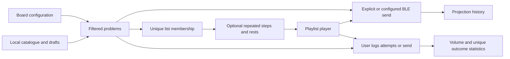
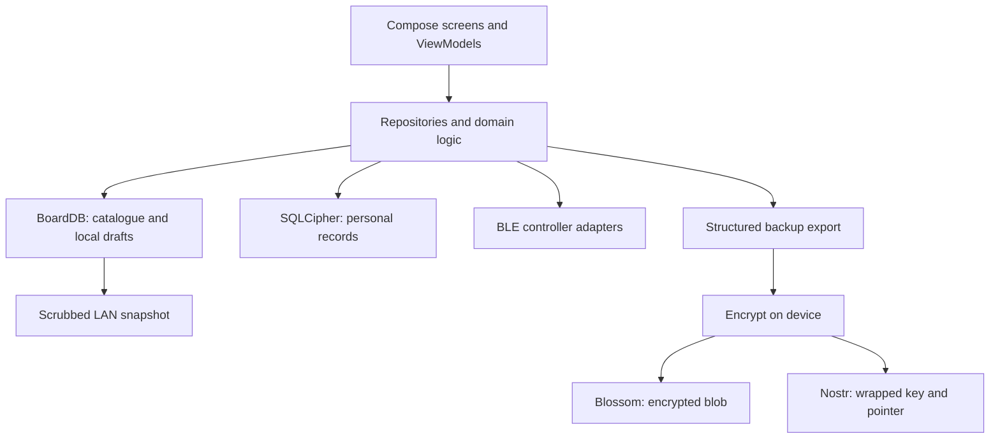

# Core concepts and architecture

[Deutsch](../de/CORE_CONCEPTS.md) · [Documentation index](../README.md)

**Scope:** implemented source at `4fc067e87`, preparing 0.2.3. Published app:
0.2.2. The outcome/count corrections below belong to this preparation line.
The section "Training and nutrition" describes `feat/0.2.5-training-nutrition` (target 0.2.5).

## Board, layout, angle, problem

A **board family** selects capabilities and a controller protocol: for example,
MoonBoard and Quantum are not interchangeable with Aurora-compatible boards.
A **layout** describes the hold arrangement. A physical installation also has
a size, mounted hold sets and supported angles. Selecting a gym helps choose
that configuration; the board-fit filter excludes climbs that cannot fit it.
A Bluetooth connection identifies the controller you can actually light.

A **problem** (called a climb in code) has an identity and hold frames. Its
**angle** is the incline used to browse, project or log it. The setter's angle
is context; community grade/quality statistics can differ by angle, and an
angle with no statistics does not automatically mean the problem is unusable.
Use the selected board's allowed angles rather than a universal Kilter range.

## Catalogue, own climbs and community

These are views of data with different origins and publication states, not
three independent copies of every problem.

- **Catalogue:** imported board content, stored locally for browsing. Import
  sources and availability differ by board; “catalogue” does not mean every
  row is an official manufacturer publication.
- **Own climbs:** authored by the active identity, including local drafts.
  Saving a draft and publishing it are separate actions.
- **Community climbs:** shared through signed Nostr events and catalogue
  convergence. A climb can remain one identity while publication destinations
  and sync state change.

The board schema keeps `origin` (where authored), `source` (current data
source), creator and publication state separately. Do not infer ownership or
publication from one field alone. A public signature identifies an author;
it does not make a climb's content or grade authoritative.

## Logbook: attempts, sends and unique outcomes

The board logbook stores **ascents** (successful sends) and **bids** (attempts
without a send). A row can consolidate multiple physical tries in `bid_count`.
Two failed tries followed by a send can therefore be three attempts and one
successful problem, rather than three separate problems.

The statistics have different denominators:

| Measure | What the current computation counts |
|---|---|
| Attempt volume | Sum of `bid_count`, at least one per entry, including send entries |
| Total sends | Successful log entries; repeat sends can count again |
| Outcome distribution / grade outcomes | One best outcome per board family and climb UUID in the selected period: flash, then redpoint, then attempted |
| Flash eligibility | First recorded entry across the full history for board family + climb UUID + angle must be a send with at most one try |

Unique outcome charts collapse angles for the same problem; flash detection
is angle-specific. Do not assume all statistics use either one of these keys.
A send in a later period does not erase the attempted outcome in an earlier
period. Missing import history also limits what can be inferred about a flash.

**History / Verlauf** is separate: it records projections sent to a board.
Lighting a problem is not proof of attempting or completing it.

## Filters and result counts

Board configuration constrains what can fit. Browser filters then narrow the
available set by grade, origin, holds, status and other selected properties.
Status buckets are disjoint: **new** has no send or bid, **attempted** has a bid
but no send, **sent** has a send. Selecting several buckets combines them;
selecting none means all statuses. These status lookups use climb UUIDs,
so they are not a per-angle attempt history.

“Ungraded only” selects missing grades; it is not the same as “attempted.”
Ignored climbs, board fit and Quantum overlap checks can further narrow the
set. On this branch, the browser result count follows the matching results,
including filters applied after the database query, rather than presenting a
raw catalogue count as the number visible. Own-climb browsing deliberately
keeps drafts discoverable across angles; check the dedicated path before
changing its filters.

The **Exclude sent problems** switch edits this same status selection. From
All or Sent-only it selects New + Attempted; a narrower unsent choice remains
narrow when toggling sent visibility. There is no separate hidden status rule.

MoonBoard preview rings retain green/blue/red role colours with light and dark
outlines. These are display strokes; the MoonBoard encoder still transmits role
tokens rather than customizable RGB values.

## Lists and playable playlists

A list is a unique set of climb memberships. Favourites are a built-in list.
Every list has playback defaults; an optional ordered plan adds repeated
climbs, pinned angles and rest steps. Four repetitions belong in that plan,
not four duplicate memberships. Deleting a plan leaves the underlying list.
The player coordinates the active step, rests and logging; starting playback
is not evidence that every step was climbed.

## Local-first storage and sync

Browsing downloaded catalogues, local logging and list management use local
storage. Initial downloads and remote features still require a network.
“Local-first” does not mean the app never contacts a server.

SQLDelight defines both database schemas. **BoardDB is unencrypted** and also
contains local climb drafts; it must not be treated as an entirely public
export. **SecureDB uses SQLCipher** for logbook and other personal records,
with database key material protected by Android Keystore. Preferences and
files exist outside these databases, so “all personal data is encrypted” is
too broad a guarantee.

Optional backup is off by default. It exports structured data, compresses and
encrypts it with an AES-GCM data key, stores the encrypted blob on Blossom,
and wraps the key and pointer in Nostr self-encryption. It is not a raw
SQLCipher-file upload and the data key is not simply the Nostr private key.
Restoring requires the same identity's decryption capability and reachable
backup data. Publishing community climbs is a separate public operation.

Nearby BLE sessions and LAN app/catalogue transfer are also separate features.
The LAN sender scrubs a snapshot before serving it; an unencrypted BoardDB
file must never be assumed safe to share directly. This tree's sharing does
not implement the proposed personal-sharing or BoardCell/FIPS mesh designs.

## Settings and explanations

The settings overview leads to twelve task pages. Titles, current values and
controls provide the main orientation; optional explanations open from the
adjacent info button. Reading help never changes a setting or opens its action.
Dialogs use readable, scrollable text and can be closed to return to the same
page. Current errors, missing prerequisites, backup status and warnings before
destructive actions stay visible where they matter.

“Board & Bluetooth” shows “Active board”, “All boards”, then “Settings for each
board”. The brand cards select which settings to inspect. Opening the
active-board picker always starts from the active board, even while inspecting
another brand; activating that other brand remains a separate explicit action.

Help explains what each choice does, when it takes effect and any relevant
prerequisites. It must not describe an optional behaviour as always active.
Check the call site and implementation when updating both English and German:
for example, automatic board sending can follow browsing and reconnecting,
while explicit sending waits for a lamp action. Shared sessions, running
playlists and Quantum layer selection add their own delivery rules. Keep
account privacy explanations specific to public profiles/climbs, encrypted
messages and encrypted backups.

Use `SettingsDestinationRow`, `SettingsToggleRow` and `SettingsInfoHeading` in
`ui/settings/SettingsLayout.kt`, with `ui/common/InfoButton.kt` for shared help.

The profile editor shows the cover and avatar together in its header, with edit
buttons on the images. Its fixed bottom bar gives local saving primary emphasis;
the secondary “Publish on Nostr” action requires an additional confirmation explaining
public image hosting and permanent copies. Local saving stays the default after
publication. Optional addresses and community options remain expandable without
losing edits.
Account management starts with the active profile and public account ID (copy or QR).
Two always-visible cards explain who manages the private key: CruxCoach on this
device, or Amber in its separate app. Wide layouts place these cards side by side.
Local key backup guides the user through explanation, device authentication, copying
and a separate confirmation of safe storage. Copying alone is not a verified backup;
recovering climbs and lists also requires a data backup. Amber users secure their
key in Amber. Existing local copies are retained unless explicitly removed, with a
second confirmation before deletion.
Import and method changes preview the target public identity before applying it.
Switching methods for the same account preserves identity-scoped sync metadata;
switching accounts keeps the existing isolation/reset behavior. Without a retained
local key, the UI offers import rather than a disconnect that creates an identity.
Private keys remain masked during import, and screenshot protection remains active.

## Board map

The map shows one marker per venue in the colour and letter of its board family (Kilter red "K", MoonBoard yellow "M", Tension slate "T", …); a venue with several families gets one pie segment per family. Nearby venues merge into neutral count bubbles that take a family's colour when the board choice leaves exactly one family. From city zoom on, gym names stand under the markers. The board chip on top lists every family with its marker and count, so it is also the legend; the filter chip carries the number of further active filters.

The bottom sheet lists the places in the visible part of the map, nearest to the map centre first (at most 50, with the true total), and shows a tapped place: name, place, boards, directions, website and phone in the collapsed sheet; per board size, angle range, setup and LEDs, the opening hours and the contact rows when pulled up. Only facts the data has are shown. Opening hours appear exactly as the venue published them (curated by cruxcoach.org); the app does not work out whether a venue is open now, because the venue's timezone and public holidays are not in the data.

The map reopens where it was left; on the first visit it frames the boards of the device's country, taken from the timezone ("Europe/Vienna" → Vienna in the bundled place index → Austria) or else the locale, without any permission. "My location" asks for the location permission only when tapped (precise or approximate, the user chooses), then shows a blue dot with its accuracy, frames the user with the three nearest boards that pass the filters, and sorts the list by distance from the user with the distance on each row. To find the position it shows the newest position the phone already knows at once (other apps' fixes included) and asks every location source the phone allows at the same time (GPS too, also with approximate) until the first fix, the way a map app keeps listening: a fix from the last two minutes is the answer, one from the last half hour is refined for up to 45 s, otherwise it looks without a time limit until a position arrives, with a "still looking" hint and Cancel after 10 s. It stops when the user cancels or leaves the screen, and pauses while the app is in the background, so it never locates there. It reports a problem only for a reason the user can act on: no permission, location switched off (also during the search), or no location source on the phone. "Search stopped" and "no location source" carry a second line naming what was tried (precise or approximate, the sources that are on and the ones asked, GPS satellites seen and used, the wait; never a position). Opening the gym search with the permission already given only looks briefly and quietly. The position stays in memory on the device and is not stored or sent. Rotation and tilt are off; the dark theme uses a dark map style.

## Finding a gym near you

The gym search behind the board picker ("Don't know?") has "Gyms near me": the ten closest gyms within 100 km that have a board CruxCoach supports, nearest first, each with its boards and distance; tapping one offers its boards as usual. The board dialog itself has "Find a gym near you", which opens the search straight in this mode. Both ask for the location permission only on that tap; once it is granted, the search shows the nearby gyms as soon as it opens (without overriding anything typed). Until the synced gym data is on the device (a first start in onboarding), search and "near me" use the board map's bundled snapshot, so they work offline from the start.

On the map, a board with a known layout opens its climbs directly ("Browse climbs for this board"). A board CruxCoach can drive but whose layout or size the data does not name (Tension, Grasshopper, Decoy, So iLL, Touchstone, Quantum, a MoonBoard of unknown variant) offers "Choose this board" instead: the same gym search with that place already open, and the chosen board goes on to the board browser.

## Board map statistics

Map statistics count all recorded boards in the loaded map dataset, independently of map filters. A venue may contain several boards. Brand and layout distributions include every board family; layout names are grouped within their brand, and missing layouts remain visible as unknown. Access, adjustability, country and known size aggregates use the same dataset.

## Training and nutrition (0.2.5)

The training area ("Training & nutrition" in the main menu) has four tabs:
Today, Training (workouts and the exercise library), Nutrition and Progress.
**Today** suggests one training from the week plan, climbing days, the
check-in, finger load of the last days, equipment of the chosen place and what
the coach learned; every exercise on the card can be swapped, left out or never
suggested again, and the reasons sit behind "Why?". Suggestions never force
anything: the athlete can always change them, and safety rules (injuries,
guardrails for young climbers and beginners, finger load) decide before
preferences. The coach learns from swaps and changes in moderation – rejected
exercises rest for days to weeks and are not suggested over and over – and
"What the coach learned" shows and forgets each item.

**Nutrition** follows the training day with transparent targets and warns
with its numbers instead of locking anything ("warn, don't block"). Foods come
from bundled BLS 4.0, USDA and Open Food Facts data, a barcode, a typed
description or an optional on-device photo model (downloaded only on request).

**Comeback plan** after an injury is a training aid, not a medical device: the
athlete enters what a doctor or physio said and picks the stage; the app never
diagnoses, never picks or changes a stage by itself and says on every comeback
screen that it is not a substitute for seeing a doctor. Healing or treatment
words are not used (`HealthWordingTest`).

**Data:** everything lives in a separate SQLCipher database per account
(`cruxcoach_athlete_<pubkey prefix>.db`, schema in `sqldelight/athlete`), opened
on first use, never at app start. Backups carry it as the additive `athlete`
part (envelope version 3, read forward-compatibly); categories Training, Body,
Nutrition are on by default, injuries and the comeback diary (`HEALTH`) only
when switched on. Health Connect is optional, one switch per direction.

## Source map

Paths below are relative to the repository, linked for direct navigation.
Read implementation and focused tests together before changing a concept.

| Concern | Source of truth |
|---|---|
| Board capabilities and codecs | [shared domain/board](../../shared/src/commonMain/kotlin/com/cruxcoach/domain/board/) |
| Browse models, queries and personal repositories | [shared data/repository](../../shared/src/commonMain/kotlin/com/cruxcoach/data/repository/) |
| Catalogue, origin and draft schema | [Board.sq](../../shared/src/commonMain/sqldelight/board/com/cruxcoach/db/board/Board.sq) |
| Ascents, bids, lists and projection history | [SecureDB schemas](../../shared/src/commonMain/sqldelight/secure/com/cruxcoach/db/secure/) |
| Filters and counts | [BoardBrowserViewModel](../../androidApp/src/main/java/com/cruxcoach/android/ui/board/BoardBrowserViewModel.kt) |
| Statistics and outcome grouping | [BoardStatsComputer](../../androidApp/src/main/java/com/cruxcoach/android/ui/board/BoardStatsComputer.kt) and [tests](../../androidApp/src/test/java/com/cruxcoach/android/ui/board/BoardStatsComputerTest.kt) |
| Playback | [PlaylistPlaybackCoordinator](../../androidApp/src/main/java/com/cruxcoach/android/data/PlaylistPlaybackCoordinator.kt) and [player UI](../../androidApp/src/main/java/com/cruxcoach/android/ui/playlist/) |
| Drafts and publication | [community](../../androidApp/src/main/java/com/cruxcoach/android/community/) |
| Key protection | [SqlCipherKeyManager](../../androidApp/src/main/java/com/cruxcoach/android/data/SqlCipherKeyManager.kt) |
| Backup envelope and restore | [backup](../../androidApp/src/main/java/com/cruxcoach/android/nostr/backup/) |
| LAN snapshot exclusions | [LocalShareSchema](../../androidApp/src/main/java/com/cruxcoach/android/data/LocalShareSchema.kt) and [wire contract](LOCAL_SHARE_CONTRACT.md) |
| Training, coach and comeback logic | [shared athlete](../../shared/src/commonMain/kotlin/com/cruxcoach/athlete/) (`logic/SessionSuggester.kt`, `logic/WorkoutPlanner.kt`, `logic/Comeback*.kt`, `logic/FuelLogic.kt`) |
| Athlete schema and migrations | [sqldelight/athlete](../../shared/src/commonMain/sqldelight/athlete/) |
| Training services, Health Connect | [athlete](../../androidApp/src/main/java/com/cruxcoach/android/athlete/) (`AthleteService.kt`, `ComebackService.kt`, `health/`) |
| Training and nutrition screens | [ui/training](../../androidApp/src/main/java/com/cruxcoach/android/ui/training/) |
| Exercise catalogue and food data | [assets/training](../../androidApp/src/main/assets/training/), [assets/fuel](../../androidApp/src/main/assets/fuel/), [foodvision](../../androidApp/src/main/java/com/cruxcoach/android/foodvision/) |
| Update integrity | [IntegrityVerifier](../../androidApp/src/main/java/com/cruxcoach/android/updater/IntegrityVerifier.kt) |

Android-specific UI, BLE, background work and dependency injection live in
`androidApp/src/main/java/com/cruxcoach/android/`. Shared Kotlin domain logic
and SQLDelight live in `shared/src/commonMain/`; shared code does not by itself
constitute a shipped iOS client.

APK signing, catalogue publisher trust and the user's Nostr identity are
separate trust domains. A content hash checks bytes, not who authorized them.
Update acceptance also checks signing identity/lineage; feature publication
has its own trusted publisher and receipt requirements. Read [SECURITY](../../SECURITY.md)
and [release status](../RELEASE_GITHUB.md) before crossing these boundaries.
